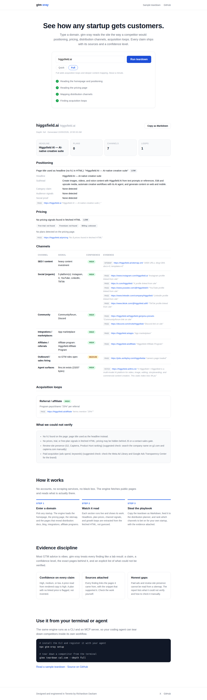

<div align="center">

# gtm-xray

**See a competitor winning. Understand exactly how they get customers, down to the channel level.**

Reverse-engineer any startup's go-to-market strategy from its public web surface, then turn the evidence into a ranked distribution plan for your own startup.

</div>

## See it working

A full teardown of higgsfield.ai, run from the web app on Oct 30, 2026: the typed domain and all four stages done, positioning from the page title and meta description, 7 channels with sources, and a referral loop at 25 percent. Pricing is the honest gap in this screenshot: Higgsfield renders its pricing in JavaScript, so the fetched HTML contains no prices, and the report says so instead of guessing them.



## Quickstart

```sh
npx gtm-xray setup
```

This registers the MCP server in your agent client (Claude Code, Cursor, Codex) and installs the `reverse-engineer-gtm` skill. It prints every change and backs up anything it overwrites.

## Ask your agent

> "Teardown how Cal.com gets customers, then build me a distribution plan for my scheduling startup for ops managers at remote startups."

Your agent runs `teardown_startup` on cal.com (positioning, pricing, channels, acquisition loops, each with evidence and confidence), then `build_distribution_plan` to rank your channel bets. A real example of the output: [showcase/cal-com-gtm-teardown.md](showcase/cal-com-gtm-teardown.md).

## CLI

```sh
# Full teardown: positioning, pricing, channels, loops
gtmx teardown cal.com cal.com --depth full --out teardown.md

# One facet at a time
gtmx positioning https://cal.com
gtmx pricing cal.com
gtmx render-pricing higgsfield.ai --screenshot pricing.png
gtmx channels cal.com
gtmx loops cal.com

# Ranked distribution plan from teardown summaries
gtmx plan --startup "One-click scheduling for remote teams" \
  --icp "Ops managers at remote-first startups, 20-200 people" \
  --price 15 --motion plg \
  --teardown '{"company":"Cal.com","channels":["SEO / content","Integrations / marketplaces"],"loops":["Templates gallery"],"price_point":15}'

# Every command takes --json and --out <file>
gtmx teardown cal.com cal.com --json --out teardown.json
```

## The evidence discipline

Every finding gtm-xray produces carries four things: the **claim**, a **confidence** level (`high` = read directly from a fetched page, `medium` = indirect signal, `low` = JS-rendered or failed fetch), the **evidence** (URL observed, snippet seen), and **limitations**. Reports end with a "What we could not verify" section. Paid ad spend and review-site presence cannot be observed from a company's site, so the tool records them as limitations with the exact manual check instead of guessing. The scoring formula for distribution plans is fixed and documented in [docs/methodology.md](docs/methodology.md):

```
score = icpFit (0-3) + intentLevel (0-2) + competitorProof (0-2) + speedBonus (0-1)
```

## How it works

- `src/gtm/`: fetch (15s timeout, browser UA, never throws on HTTP errors), regex HTML extractor (no cheerio), sitemap content-footprint counter, positioning, pricing heuristics (paired monthly plus annual, per-plan credits or seats, trial days), channel mapping, loop detection, motion and funnel verdict, teardown orchestration with rendered pricing fallback, distribution planner, Markdown/JSON report renderer.
- `src/server/`: MCP server over stdio with six tools (`teardown_startup`, `analyze_positioning`, `analyze_pricing`, `map_channels`, `find_acquisition_loops`, `build_distribution_plan`). Contracts in [docs/mcp-contracts.md](docs/mcp-contracts.md).
- `src/cli.ts`: the `gtmx` CLI, including `setup`.
- `.agents/skills/reverse-engineer-gtm/`: the agent skill.
- Runtime dependencies: `@modelcontextprotocol/sdk` and `playwright` (Playwright is used only when teardown needs rendered pricing, or when `render-pricing` runs; fetch-only teardowns do not launch a browser). Node 22+.

## Docs

- [Installation](docs/installation.md)
- [Methodology](docs/methodology.md)
- [CLI reference](docs/cli.md)
- [MCP contracts](docs/mcp-contracts.md)

## Development

```sh
npm install
npm run build   # tsc, must be clean
npm test        # vitest, must pass
```

## License

MIT. See [LICENSE](LICENSE).
